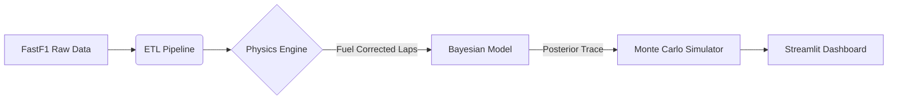

# 🏎️ Probabilistic F1 Strategy Advisor


A probabilistic decision-support system for Formula 1 race strategy. This project moves beyond deterministic lap predictions to model **risk** and **uncertainty**, simulating thousands of race scenarios to optimize pit-stop windows.

**[🔴 Live Demo - F1 Strategy Advisor](https://f1-strategy-advisor.streamlit.app)**

---

## 🎯 Project Goal
In F1, strategy isn't about predicting the exact lap time; it's about quantifying the risk of being overtaken. This tool builds a **"Shadow Pit Wall"** that:
1.  **Learns Tire Physics:** Uses Hierarchical Bayesian Modeling to estimate latent tire degradation parameters from noisy public telemetry.
2.  **Simulates Duels:** Runs Monte Carlo simulations to predict the probability of a successful "Undercut" against a specific rival.

## ⚡ Key Features

### 1. Physics-Based Feature Engineering
* **Fuel Correction:** Isolates true tire wear by mathematically removing the "fuel burn" effect (~0.035s gain/lap) from raw lap times.
* **Clean Air Filtering:** Automatically filters out laps affected by Safety Cars, VSCs, or heavy traffic to ensure pure pace analysis.

### 2. Bayesian Tire Modeling (PyMC)
* Instead of simple linear regression, the model learns a **distribution** of degradation rates for Soft, Medium, and Hard compounds.
* **Output:** "Soft tires degrade at $0.12s \pm 0.02s$ per lap," allowing for confidence intervals in strategy planning.

### 3. The "Duel" Simulator
* **Scenario:** You are Max Verstappen, chasing Lewis Hamilton. Gap: 2.5s.
* **The Question:** If you pit now, what is the probability you emerge ahead?
* **The Engine:** Simulates 2,000 parallel race futures to output a probability distribution of the final gap.

## 🛠️ Tech Stack
* **Data Ingestion:** `FastF1`, `Pandas` (ETL pipeline).
* **Probabilistic Modeling:** `PyMC`, `Arviz` (MCMC sampling).
* **Simulation:** `NumPy` (Vectorized Monte Carlo engine).
* **Visualization:** `Streamlit`, `Matplotlib`, `Seaborn`.

## 🏗️ Architecture


## 🚀 Quick Start

### 1. Installation
Recommended to use Conda due to PyMC's C++ dependencies.
```bash
conda create -c conda-forge -n f1-strategy "pymc>=5" pytensor numpy pandas seaborn streamlit
conda activate f1-strategy
pip install fastf1
``` 

### 2. Run the Pipeline
```bash
python main.py
``` 

### 3. Launch the Dashboard
```bash
streamlit run src/app.py
``` 

## 📂 Project Structure

```mermaid
f1-strategy-advisor/
├── data/
│   └── processed/       # Parquet files with fuel-corrected telemetry
├── src/
│   ├── ingestion.py     # ETL & Physics Logic
│   ├── models.py        # PyMC Probabilistic Model definitions
│   ├── simulation.py    # Monte Carlo Race Engine
│   └── app.py           # Streamlit Dashboard Entrypoint
├── notebooks/           # EDA and Prototyping
├── main.py              # Pipeline orchestration
└── README.md
``` 

## ⚠️ Limitations & Future Work
* **Traffic Model:** Currently uses a simplified gap-based proxy for "dirty air." Future updates will implement a full multi-agent traffic simulation.
* **Data:** Relies on public timing loops (FastF1). Does not have access to internal team telemetry (tire temperatures/pressures).